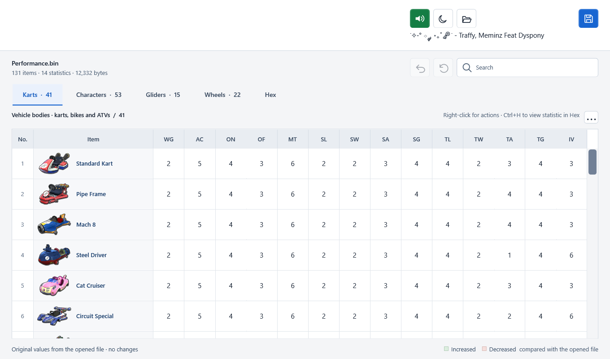
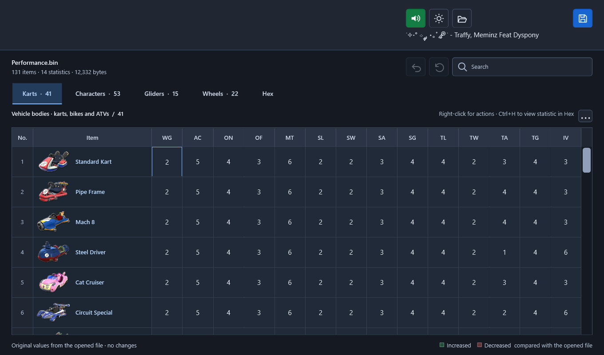
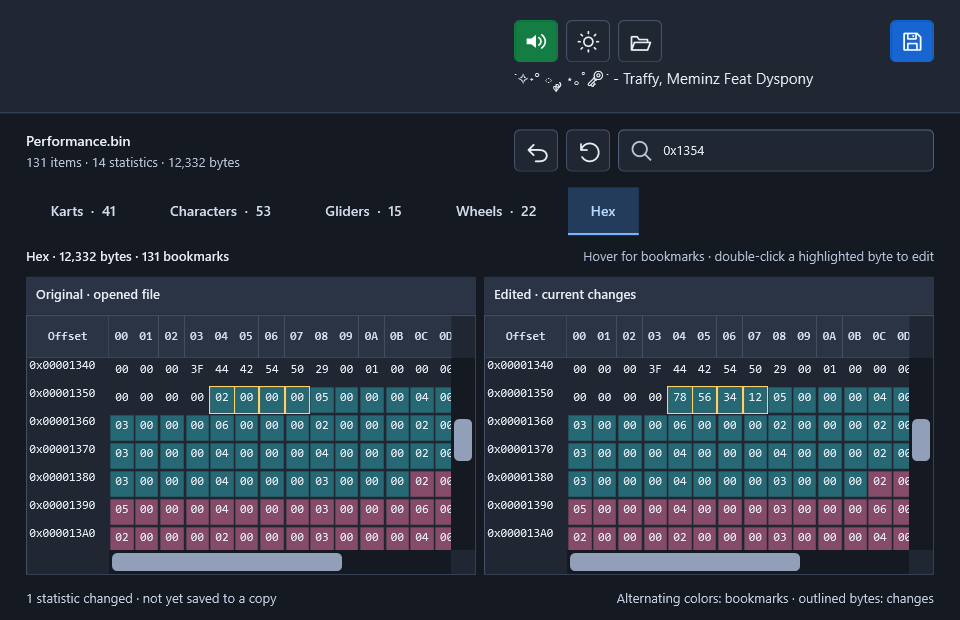

# mk8deluxe editor

An unofficial desktop editor for the supported Mario Kart 8 Deluxe `Performance.bin`
layout, by **Traffy** ([Traffyyy](https://github.com/Traffyyy)). First release: **1.0.0**.

The original Windows WPF application is preserved in `Source/`. A separate Avalonia
application in `CrossPlatform/` provides Windows x64, macOS Apple Silicon/Intel and
Linux x64 build targets. Native macOS/Linux validation is pending: see
[platform support](docs/PLATFORM-SUPPORT.md) and [verification](VERIFICATION.md).

## Features

- Four item categories: 41 vehicle bodies, 53 characters, 22 wheels and 15 gliders.
- Fourteen raw integer statistics per item, with artwork and name search.
- Copy all statistics between items and apply a value to selected numeric cells.
- Undo for single edits and complete batch operations; Reset to the opened values.
- Linked Original/Edited Hex views, bookmarks, tooltips and changed-byte outlines.
- Two-way navigation between statistics and their bytes.
- Light/dark themes and the original bundled music with playback/volume controls.
- Save to a new file; the opened file and existing destinations are not overwritten.

## Download and start

Download available packages from [Releases](https://github.com/Traffyyy/mk8deluxe-editor/releases).
Choose the archive matching your operating system and processor, then extract it fully.
Keep the entire extracted folder together, including `Audio/reference.wav`.

| Package | Start |
| --- | --- |
| Original Windows x64 (WPF) | `mk8deluxe editor.exe`; requires .NET Framework 4.8 |
| Cross-platform Windows x64 | `Mk8Editor.Desktop.exe`; .NET runtime included |
| macOS Apple Silicon (`osx-arm64`) | `mk8deluxe editor.app` |
| macOS Intel (`osx-x64`) | `mk8deluxe editor.app` |
| Linux x64 (`linux-x64`) | Run `./mk8deluxe-editor` from the extracted folder |

The macOS packages target macOS 15 or newer; Linux validation targets Ubuntu 24.04.
See [platform support](docs/PLATFORM-SUPPORT.md) for dependencies and verification limits.
The Windows executables have no publisher certificate. Native macOS packages use an
ad-hoc signature, with no Developer ID certificate or Apple notarization. SHA-256
checksums detect changed downloads; they do not authenticate the publisher.

No game binary, ROM, encryption key, emulator or mod is included. Supply your own
supported `Performance.bin`. The editor does not need a network connection.

## Use

Open a file with the folder button or Ctrl+O, select a category, then edit a numeric
cell. Ctrl+Z undoes an edit. Reset restores the opened values and clears Undo history.
Save a new copy with the disk button or Ctrl+Shift+S.

Values are raw unsigned 32-bit integers (0–4294967295), not the bars in the game menu.
An accepted value is not a promise of meaningful or stable gameplay behavior.

Ctrl+Shift+C copies a row's 14 statistics. Select destination cells and use
Ctrl+Shift+V to paste into their rows. Ctrl+click or Shift+click selects numeric
cells; Ctrl+Enter sets selected fields to one value. The actions menu provides
these commands too. The shortcuts are expressed as Ctrl throughout this README;
use the commands shown by the application on your platform.

Clipboard order: WG, AC, ON, OF, MT, SL, SW, SA, SG, TL, TW, TA, TG, IV.
Full-item paste accepts exactly 14 nonnegative whole numbers separated by whitespace.

Original Hex retains the snapshot captured at open; Edited includes unsaved changes.
Saving a copy does not move that baseline. Hex is an inspection/navigation view:
headers and non-statistic bytes remain outside the editable fields. The comparison
is implemented in this application and does not embed ImHex.

The interface is English; native file dialogs follow the operating system. Music
starts at 35% and loops. Preferences are not persisted between runs.

## Supported layout

The parser requires PTBD/41, PTDV/53, PTTR/22 and PTWG/15 in that order, with
14 little-endian u32 fields per record. Section addresses are read from the file;
unknown layouts are rejected. Compatibility with every game update is not claimed.
The final character entry is Mii (DLC costumes), using a representative image.

## Source and licensing

Original project code is [MIT licensed](LICENSE), copyright 2026 Traffy.
The MIT grant excludes Nintendo artwork, the icon derived from that artwork, the
bundled recording and other third-party components. The publisher has chosen to
include the existing media as-is; this does not establish permission from their
rights holders. See [license scope](LICENSE-STATUS.md) and
[third-party notices](THIRD-PARTY-NOTICES.md).

See [building](BUILDING.md), [changelog](CHANGELOG.md) and
[contributing](CONTRIBUTING.md). This project is not affiliated with or endorsed by Nintendo.

## Original Windows interface previews

These are actual off-screen WPF renders. They do not demonstrate native macOS/Linux behavior.

